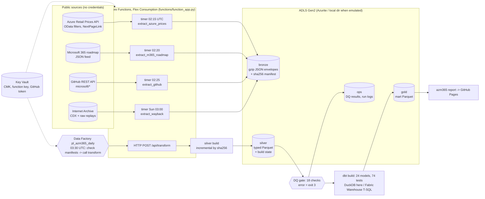

# Azure prices, Microsoft 365 / Copilot roadmap and Microsoft OSS analytics on an Azure lakehouse

[](https://github.com/rohit91jacob/microsoft-azure-m365-copilot/actions/workflows/ci.yml)
[](https://github.com/rohit91jacob/microsoft-azure-m365-copilot/actions/workflows/refresh.yml)
[](https://rohit91jacob.github.io/microsoft-azure-m365-copilot/)
[](LICENSE)
[](DATA_LICENSE.md)


A data-engineering project on three **real, public, credential-free** Microsoft data sources,
built the way it would run on Azure: timer-triggered **Azure Functions** extractors land raw
snapshots in an **ADLS Gen2** medallion lake (bronze/silver/gold), a data-quality gate guards
silver, **dbt** builds the marts, and **Azure Data Factory** orchestrates the daily transform.
Infrastructure is **Terraform (azurerm)**. Everything runs locally with emulators: the lake on
a directory or on **Azurite**, dbt on **DuckDB** (with a **Fabric Warehouse** target that
compiles to T-SQL in CI). No Azure subscription was used to build or test it.

* **FinOps** - the [Azure Retail Prices API](https://learn.microsoft.com/rest/api/cost-management/retail-prices/azure-retail-prices):
  daily snapshots of ~49,000 price points (six popular VM sizes in every region, Blob
  storage, Functions, Foundry/Azure OpenAI models), price changes between snapshots back to
  June 2024 from Internet Archive captures, the cheapest region per meter, and a per-service
  region price index.
* **Microsoft 365 / Copilot roadmap** - the public [roadmap feed](https://www.microsoft.com/microsoft-365/roadmap):
  feature cadence by product, status and GA month, the Copilot share, and **slippage** (GA
  months that move between snapshots) since February 2025.
* **Engineering throughput** - the GitHub API on microsoft/vscode, TypeScript, semantic-kernel
  and autogen: weekly commits, merged PRs, time to merge, release cadence.
* **Not here: Office/Copilot usage.** Microsoft does not publish product telemetry, so this
  project measures announced features and their dates, never adoption or usage.

**Results** (fresh live run, 9 October 2026; all numbers below are from that run):

* The roadmap lists **1,902** features; **637 (33.5%)** mention Copilot. 175 features tagged
  *Microsoft Copilot (Microsoft 365)* have a planned GA month that has already passed and are
  not marked Launched.
* Between the January and October 2026 snapshots, **255 of 908** features with a GA month in
  both (28%) slipped, by 5.3 months on average; Copilot features: 99 of 339.
* **D2s v5 Linux** costs USD 0.096/h in East US, the cheapest of 54 rankable regions (median
  0.115, Brazil South 0.153). Across all VM meters, West US 2 is 3.5% below East US and Brazil
  South 44% above.
* Reconciliation against independently published channels: **618/618** VM prices, **58/58**
  storage tier tables and **50/50** Functions tier tables match Microsoft's pricing-calculator
  data; the roadmap JSON and RSS feeds agree on all 1,902 features, their status and GA month;
  GitHub release tags match npm, PyPI and the VS Code release notes. One mismatch is reported in
  [docs/verification.md](docs/verification.md).

## Architecture



| Component | Code | What it does |
|---|---|---|
| Extractors | `src/azm365/extract/{prices,roadmap,github,wayback}.py` | One bronze snapshot per scope per UTC day; already-landed scopes are skipped, so retries and duplicate timer firings are no-ops. Retail Prices follows `NextPageLink` to exhaustion (or `--max-pages`, marked incomplete). GitHub drops logins and PR text at extraction. Wayback lands each distinct archived capture of the same two Microsoft endpoints |
| HTTP | `src/azm365/http.py` | Retries with backoff and `Retry-After` on 429/5xx; a fixture fetcher with the same interface serves the simulated test responses by request key |
| Lake | `src/azm365/lake.py` | The same four containers on a local directory, Azurite (connection string) or ADLS Gen2 (`DefaultAzureCredential`, no keys). Atomic local writes; path traversal rejected |
| Bronze | `src/azm365/bronze.py` | Deterministic gzip envelopes (same payload, same bytes), manifest written after the object, sha256 verified on read |
| Silver | `src/azm365/silver.py` | Typed PyArrow schemas, lineage on every row, rebuilt only when the bronze sha256 changes |
| Data quality | `src/azm365/quality.py` | 18 SQL checks over silver; error-level failures stop the run before dbt |
| Transform | `dbt/` | staging -> intermediate -> marts, contracts enforced on marts, 74 data tests, cross-database macros for DuckDB and Fabric T-SQL |
| Orchestration | `functions/function_app.py`, `orchestration/adf/*.json` | Timer extractors; ADF pipeline (Get Metadata on `bronze/_manifest` -> If -> Azure Function activity) read by Terraform |
| Infrastructure | `infra/` | Terraform azurerm 5.9: VNet + service endpoints, ADLS Gen2 with CMK, Flex Consumption app with managed identity, Key Vault (RBAC, purge protection), Data Factory, Log Analytics with daily caps, budget, GitHub OIDC deploy identity |
| Results site | `src/azm365/report.py` | Static HTML + `summary.json` from the gold marts; inline SVG, light/dark |
| Verification | `scripts/verify_published.py` | Reconciles outputs with Microsoft's pricing-calculator data, the roadmap RSS feed, npm, PyPI and the VS Code release notes |

## Tech stack

| Layer | Technology | Version |
|---|---|---|
| Language / packaging | Python, uv, hatchling | 3.12, uv.lock pinned |
| Storage SDK | azure-storage-blob, azure-identity | 12.31.0, 1.26.0 |
| Functions | azure-functions (Python v2 programming model), Flex Consumption | 1.25.0 |
| Files | PyArrow Parquet (zstd) | 26.0.0 |
| SQL engine (local) | DuckDB | 1.5.6 |
| Transform | dbt-core, dbt-duckdb; dbt-fabric (compile only) | 1.11.15, 1.11.0, 1.11.1 |
| Blob emulator | Azurite (npm, pinned in `package.json`) | 3.37.0 |
| IaC | Terraform, azurerm, azuread; tflint + azurerm ruleset; checkov | 1.16.5, 5.9.0, 3.10.0; 0.64.0 + 0.32.0; 3.3.26 |
| Quality | pytest, pytest-cov, responses, ruff, pre-commit, gitleaks, Dependabot | 9.1, 7.1, 0.26, 0.16, 4.6, 8.30 |

## Data sources

| Source | Endpoint | Licence / terms | Refresh cadence | Known gaps |
|---|---|---|---|---|
| Azure Retail Prices API | `https://prices.azure.com/api/retail/prices` (`api-version=2023-01-01-preview`, OData `$filter`, 1,000 items per page) | Microsoft APIs Terms of Use; not redistributed ([DATA_LICENSE.md](DATA_LICENSE.md)) | Microsoft reprices continuously (effective dates are mostly month starts); pulled **daily** | No history API: history is the pipeline's own daily snapshots plus 5 Internet Archive captures (Jun 2024 - Feb 2026) of page 1 of Spain Central only. List prices only (no EA/MCA discounts). Reservation prices are per term |
| Microsoft 365 roadmap | `https://www.microsoft.com/releasecommunications/api/v1/m365` (RSS: `/api/v2/m365/rss`) | Microsoft Terms of Use; counts and IDs only on the site | Edited most days (RSS `ttl` 1440 min); pulled **daily** | Features are removed some time after launch; archived history is 7 captures (Feb 2025 - Jan 2026) with multi-month gaps, so slippage between captures is aggregated over those gaps |
| GitHub REST API | `api.github.com/repos/microsoft/{vscode,semantic-kernel,autogen,TypeScript}` | GitHub Terms of Service; no personal data kept | Continuous; pulled **daily**; token optional (60 -> 5,000 req/h) | Commits = default branch only, 52 weeks; PR metrics from the 300 most recently updated closed PRs; release cadence mixes release streams |
| Internet Archive | `web.archive.org/cdx/search/cdx` + `/web/<ts>id_/<url>` | Internet Archive terms; Microsoft content | Weekly in Functions; best effort daily in `refresh.yml` | CDX API often answers 503 (retried) |
| Office / Copilot usage | - | not published | - | **Not available. Nothing in this repository estimates it.** |

## Data model

| Layer | Tables (grain) |
|---|---|
| Bronze | one gzip JSON envelope per (source, scope, snapshot) + manifest |
| Silver | `prices` (price point x snapshot), `roadmap_features` (feature x snapshot), `roadmap_feature_tags`, `gh_repos`, `gh_commit_weeks`, `gh_releases`, `gh_pulls` |
| Marts: FinOps | `mart_price_changes`, `mart_price_change_summary`, `mart_cheapest_region`, `mart_region_price_index`, `mart_price_effective_months` |
| Marts: roadmap | `mart_roadmap_cadence`, `mart_roadmap_monthly_additions`, `mart_roadmap_slippage`, `mart_roadmap_slippage_by_product` |
| Marts: engineering | `mart_repo_weekly_throughput`, `mart_repo_summary` |
| Ops | `dq_results`, `runs/latest_gold` |

Columns, keys and definitions are in the **[data dictionary](docs/data_dictionary.md)**.

## Quickstart

Prerequisites: Python 3.12 + [uv](https://docs.astral.sh/uv/); Node 20+ only for Azurite;
Terraform and tflint only for the infrastructure checks. `make help` lists every target (the
Makefile needs GNU make; each target is a one-line `uv run ...` you can also run directly).

```bash
git clone https://github.com/rohit91jacob/microsoft-azure-m365-copilot.git
cd microsoft-azure-m365-copilot
uv sync --frozen
uv run azm365 run                 # live: extract -> bronze -> silver -> DQ -> dbt build -> gold
uv run azm365 report --out site   # open site/index.html
```

A run into an empty data directory on 9 October 2026 took **5 min 32 s** on a laptop: 48,999
price items over 5 scopes (27 s), 1,902 roadmap features (3 s), 4 repositories (21 s), 12
Internet Archive captures (3 min 22 s, mostly 503 retries), then silver, 18 DQ checks and
`dbt build` (PASS=100). The lake was 10 MB. Running it again the same day lands nothing.

Offline, on the **simulated** fixtures (two fake days, labelled SIMULATED everywhere):

```bash
make demo        # or: uv run azm365 run --fixtures tests/fixtures/http --as-of 2026-01-05  (then 2026-01-06)
make test        # unit + end-to-end + idempotency (Azurite tests skip unless it is running)
```

Against the Azurite Blob emulator:

```bash
npm ci && npm run azurite        # Blob on 127.0.0.1:10000
uv run pytest -m azurite         # whole pipeline with every container on Azurite
```

Infrastructure checks (no Azure account needed): `make infra-check`
(`terraform fmt -check`, `init -backend=false`, `validate`, `tflint`, `checkov`).

## Local emulator -> real Azure service

| Here (emulated / local) | On Azure | Status |
|---|---|---|
| `AZM365_LAKE=local` directory tree or **Azurite** Blob (`npm run azurite`) | **ADLS Gen2** (StorageV2, hierarchical namespace), containers bronze/silver/gold/ops, managed identity + RBAC | Code path for ADLS (`DefaultAzureCredential`) is the same `BlobLake` used with Azurite; not run against a real account |
| `azm365 extract` / `run` CLI | **Azure Functions** Flex Consumption, Python 3.12, 4 timer triggers + `transform` HTTP trigger | `function_app.py` is unit-tested (triggers, schedules, status codes); not deployed |
| Silver read in place (local) / mirrored to local disk (Azurite) + **DuckDB** | **Fabric Warehouse** (dbt-fabric) or Synapse serverless over OneLake/ADLS shortcuts | dbt project compiles to T-SQL for Fabric in CI (`dbt compile --target fabric`); never run against a warehouse |
| `azm365 run --skip-extract` | **Azure Data Factory** `pl_azm365_daily` + schedule trigger, calling `transform` | Pipeline JSON validated by tests and loaded by Terraform; not deployed |
| `.env` / environment variables | App settings + **Key Vault** references (`@Microsoft.KeyVault(...)`) | Terraform only |
| `ops/dq_results`, logs | **Log Analytics** + workspace **Application Insights**, scheduled-query and metric alerts -> action group | Terraform only |
| GitHub Actions `refresh.yml` on a runner | The Functions + ADF schedule above | The public results site is produced by GitHub Actions, not by Azure |

## Cost notes

Nothing here has been deployed, so these are **list-price estimates**, not bills. Prices
quoted come from this pipeline's own 9 October 2026 snapshot (East US) unless noted.

| Item | Driver | Estimate |
|---|---|---|
| Functions Flex Consumption | ~5 short invocations/day; on-demand execution time is free up to 100,000 GB-s and 250,000 executions a month, then USD 0.000026 per GB-s | A daily transform of a few minutes at 2 GB is roughly 10,000-20,000 GB-s a month: inside the free grant |
| ADLS Gen2 lake | ~10 MB per day of bronze + silver; Hot LRS is USD 0.0208 per GB-month (GZRS costs more), tiered to Cool/Cold after 30/90 days | Cents per month in the first year |
| Data Factory | 1 pipeline run a day, 3 activities | Orchestration is billed per 1,000 activity runs; ~90 runs a month |
| Key Vault Premium | 1 HSM-protected key + a few secrets and operations | Around USD 1 per month for the key (not in this pipeline's price scopes; check the Retail Prices API) |
| Log Analytics / App Insights | Daily ingestion capped at 0.1 GB (`log_daily_quota_gb`) | Bounded by the cap |
| Private endpoints, NAT gateway | Not used: storage and Key Vault firewalls admit the Function subnet via free service endpoints | Avoids roughly USD 7 per endpoint per month (6 would be needed) and a NAT gateway |

Guardrails in Terraform: a monthly **budget** on the resource group (default USD 25) with
50/80/100% actual and 100% forecast alerts, daily log caps, a Function scale-out ceiling, and
lifecycle tiering of bronze.

## Security

* No keys, SAS tokens or connection strings: `shared_access_key_enabled = false`, managed
  identities with data-plane RBAC scoped to single resources, Key Vault in RBAC mode.
* Customer-managed key (HSM-backed, auto-rotated) plus infrastructure encryption on the lake;
  TLS 1.2 minimum; storage and Key Vault firewalls default to Deny.
* The deploy workflow uses GitHub OIDC federation to an Entra ID app that can only publish to
  the one Function App, and only from the `production` environment. It is off unless the
  repository variable `AZURE_DEPLOY_ENABLED` is `true`.
* checkov passes with 18 inline-justified skips (service endpoints instead of private
  endpoints, Flex plan specifics, no queues on the lake, ADF authored from Git).
* gitleaks runs in pre-commit and CI; `.env` is ignored; `.env.example` is provided.

## CI and scheduled jobs

| Workflow | What it does |
|---|---|
| `ci.yml` | ruff, lockfile, fixture freshness, gitleaks; unit tests + coverage; the pipeline on fixtures for two days plus a no-op rerun, `dbt build`, `dbt docs`, end-to-end and idempotency tests, site; `dbt compile --target fabric`; an **Azurite** job (npm) running the whole pipeline on the Blob emulator; Terraform fmt/validate/tflint/checkov. Actions are pinned by SHA |
| `refresh.yml` | Daily 04:30 UTC: restore the cached lake, extract today's snapshots, best-effort Wayback, transform, publish the site to GitHub Pages; opens an issue on scheduled failures |
| `keepalive.yml` | Re-enables the scheduled workflows twice a month so GitHub does not disable them |
| `deploy.yml` | Gated, OIDC-only publish of the Functions bundle to an existing Azure deployment |

The CI jobs that need Docker (gitleaks container) or a Linux runner (the Azurite and Terraform
jobs) were written to mirror commands verified locally on Windows; they have not run on GitHub
yet.

## Limitations

* **Emulated, not deployed.** The Azure resources are defined and statically validated; no
  `terraform apply`, Function deployment or ADF run has happened. Flex Consumption specifics
  (identity-based `AzureWebJobsStorage`, VNet outbound via default outbound access) follow the
  documentation but are untested.
* **History is short and uneven.** Price history before the first live run covers only one
  1,000-item page of one region; roadmap history is 7 archived captures months apart. Each
  daily run adds one complete snapshot, and only if the cached lake survives (see runbook).
* **Region rankings** exclude a hand-maintained list of sovereign, operator-edge and
  restricted-access regions (`dbt/seeds/region_exclusions.csv`); new restricted regions need
  adding by hand.
* **Copilot features** are identified by the word "Copilot" in the title or product tags, so
  features that use Copilot without saying so are missed.
* **GitHub metrics** are samples: 52 weeks of default-branch commits, the 300 most recently
  updated closed PRs, the first 100 releases; release streams within a repository are mixed
  (see [verification](docs/verification.md)).
* **Fabric target** is compile-only. A Synapse serverless target was not added: serverless SQL
  pools cannot materialise tables, and dbt-synapse is built for dedicated pools.

## Docs

[Data dictionary](docs/data_dictionary.md) · [Runbook](docs/runbook.md) ·
[Verification](docs/verification.md) · [Data licence](DATA_LICENSE.md) ·
[ADF orchestration](orchestration/adf/README.md)
